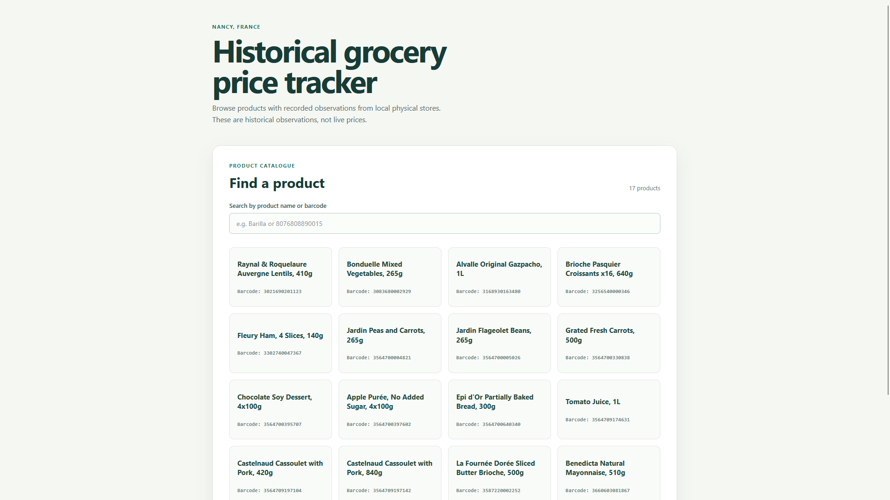
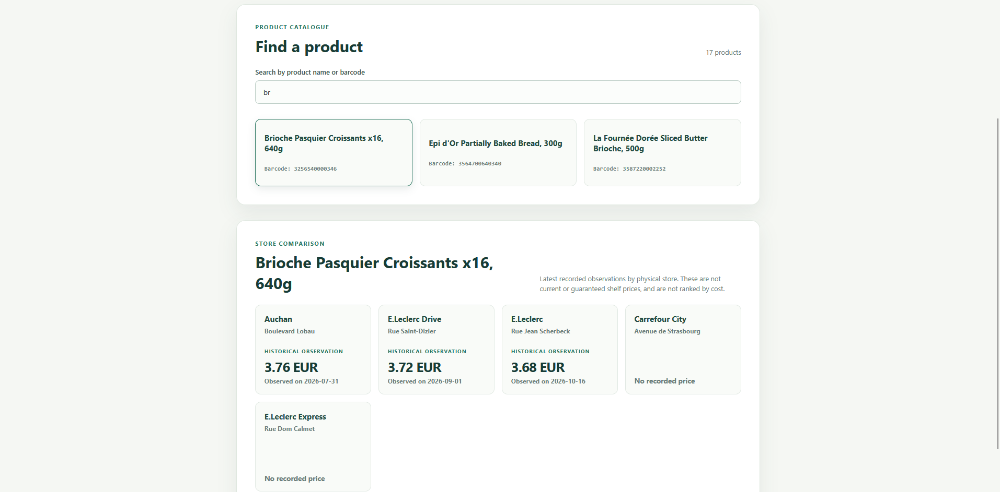
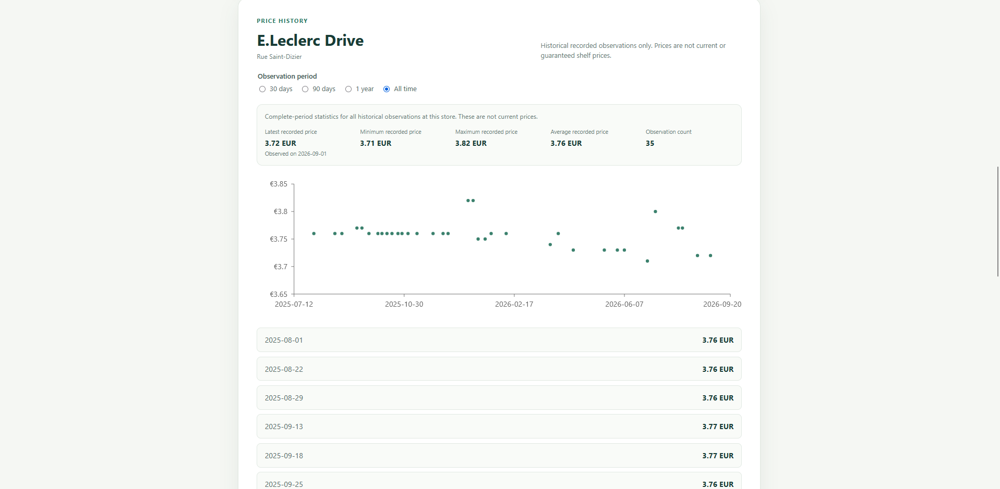

# Grocery Price Tracker

Grocery Price Tracker is a small serverless application for exploring **historical observed grocery prices** in Nancy, France. It is designed as an internship portfolio project demonstrating a practical data pipeline, DynamoDB access patterns, a read-only REST API, and a React frontend.

> **Historical-data limitation:** prices come from crowdsourced Open Prices observations. They are dated records, not live shelf prices, guaranteed current prices, sale confirmations, or retailer rankings.

## Live demo

**[Open the deployed Grocery Price Tracker](https://d1jzmtqwkf5hmn.cloudfront.net)**

The demo uses the deployed read-only API at `https://apgc1a8kvi.execute-api.us-east-2.amazonaws.com`.

## Screenshots







## Key features

- Browse and search a curated catalogue of packaged products by name or barcode.
- Compare the latest available **observed** price for each supported physical store.
- View 30-day, 90-day, one-year, or all-time observation history.
- Retrieve paginated history and calculate complete-period statistics in the frontend.
- Show observation dates, store identity, empty states, loading states, and API errors explicitly.
- Preserve decimal-safe prices and distinguish observation dates from source update timestamps.
- Ingest only curated Nancy products and physical store IDs from the daily Open Prices Parquet export.
- Re-run ingestion safely through source-ID idempotency and newer-source-version corrections.

## Technology stack

- **Frontend:** React, TypeScript, Vite, TanStack Query, Recharts, and `big.js`
- **Backend:** Python, AWS Lambda, Boto3, PyArrow, and pytest
- **API:** API Gateway HTTP API with one read-only Lambda and four routes
- **Storage:** DynamoDB `Products` and `PriceObservations` tables plus the `ProductStoreHistoryIndex` GSI
- **Ingestion:** EventBridge Scheduler invokes a daily Lambda batch
- **Hosting:** private S3 bucket delivered through CloudFront Origin Access Control (OAC)

## Architecture and data flow

```text
Open Prices daily Parquet export
              |
EventBridge daily schedule
              v
      Python ingestion Lambda
   filter -> validate -> normalize
    -> idempotent upsert/correction
              |
              v
  DynamoDB PriceObservations
  DynamoDB Products (curated)
              ^
              |
        API Lambda (read-only)
              ^
              |
       API Gateway HTTP API
              ^
              |
React + TanStack Query in browser
              ^
              |
   CloudFront <- private S3 site assets
```

The ingestion stage streams Parquet batches, filters by curated barcode and physical store ID, validates `PRODUCT` observations in EUR, and writes decimal-safe values. The API reads the curated catalogue and history index. The frontend follows continuation tokens until all history pages for a selected product, store, and period are loaded, then computes complete-period statistics.

## Engineering highlights

- Source observation ID is the primary persistence identity, supporting idempotent imports.
- Newer source update timestamps can correct existing observations; stale versions do not overwrite newer data.
- Physical store IDs remain distinct rather than being merged by retail-chain name.
- DynamoDB access patterns use a product/store history GSI and bounded API pages.
- Decimal values remain strings at the JSON boundary and are aggregated without binary floating-point arithmetic.
- Missing observations are shown as missing; the application does not interpolate dates or infer current prices.
- Source deletions are not automatically reconciled, so retained records may outlive upstream deletions.

## Local development

### Prerequisites

- Python 3.14 or a compatible supported Python version
- Node.js and npm compatible with the versions in `frontend/package-lock.json`
- Docker Desktop only if building or running the ingestion Lambda container
- AWS credentials only for commands that intentionally access deployed DynamoDB/Lambda resources

### Backend setup and tests

From the repository root:

```powershell
py -3.14 -m venv .venv
.\.venv\Scripts\python.exe -m pip install -r backend\requirements.txt
.\.venv\Scripts\python.exe -m pytest backend\tests
```

Using the virtual environment's Python executable directly also works when PowerShell execution policy blocks activation scripts. The local importer defaults to a dry run. A real import requires an explicit `--apply` flag and AWS permissions; it is not needed to run the test suite.

### Frontend setup, development, and tests

```powershell
cd frontend
npm.cmd ci
Copy-Item .env.example .env.local
# Set VITE_API_BASE_URL in .env.local to the API base URL.
npm.cmd run dev
```

Run the frontend checks:

```powershell
npm.cmd test
npm.cmd run lint
npm.cmd run build
```

## API summary

All successful responses are wrapped as `{"data": ...}`. Errors use `{"error": {"code": "...", "message": "..."}}`.

| Method and path | Purpose |
| --- | --- |
| `GET /products` | Return the curated product catalogue. |
| `GET /stores` | Return curated physical stores, IDs, names, and addresses. |
| `GET /products/{barcode}/comparison` | Return the newest available observation for each supported store with data. |
| `GET /products/{barcode}/history?storeId={id}&period=90d&pageSize=100&continuationToken=...` | Return ordered observations and page-scoped statistics for `30d`, `90d`, `1y`, or `all`. |

History requires `storeId`, defaults to `90d`, and may return an opaque continuation token. The frontend retrieves every page before displaying complete-period statistics. Empty history is a successful `200` response with no observations and unavailable statistics; invalid requests return `400`, unknown products return `404`, and unexpected failures return `500`.

## Deployment

The current MVP was deployed manually in `us-east-2`: the frontend is built with Vite and uploaded to a private S3 bucket, and CloudFront serves it through OAC. API Gateway, Lambda, DynamoDB, and EventBridge provide the backend and scheduled ingestion.

See [the deployment runbook](docs/deployment.md) for reproducible read-only checks, future frontend publishing commands, cache headers, the restricted bucket policy shape, and optional invalidation. The design rationale is documented in [the architecture](docs/architecture.md), [the engineering decisions](docs/decisions.md), and [the requirements](docs/requirements.md).

## Known limitations

- Coverage is intentionally limited to a curated set of products and physical stores in Nancy, France.
- Open Prices observations are crowdsourced and historical; availability, age, and store coverage are uneven.
- The application does not provide live prices, promotions, deal rankings, predictions, or retailer scraping.
- Upstream source deletion/retraction reconciliation is deferred.
- DynamoDB GSI reads are eventually consistent, so a newly ingested observation may be briefly absent.
- AWS deployment remains manual for this MVP; AWS SAM and GitHub Actions are intentionally deferred.
- No source-code `LICENSE` file has been added; that licensing decision remains pending.

## Data attribution and licensing

Price observations are sourced from **[Open Prices](https://prices.openfoodfacts.org/)**, an Open Food Facts project. The daily Parquet dataset used by this project is published at **[Open Prices on Hugging Face](https://huggingface.co/datasets/openfoodfacts/open-prices)**. Open Prices documents its data access and attribution guidance in **[its data guide](https://openfoodfacts.github.io/open-prices/guides/data/)**.

Open Prices data is subject to the **[Open Database License (ODbL)](https://opendatacommons.org/licenses/odbl/)**. Reusers should review the official **[Open Food Facts licensing guidance](https://openfoodfacts.github.io/documentation/docs/Product-Opener/api/tutorials/license-be-on-the-legal-side/)** and determine their own obligations for attribution, share-alike, and any derived database. This README records the source and links; it does not make a legal-compliance determination.
